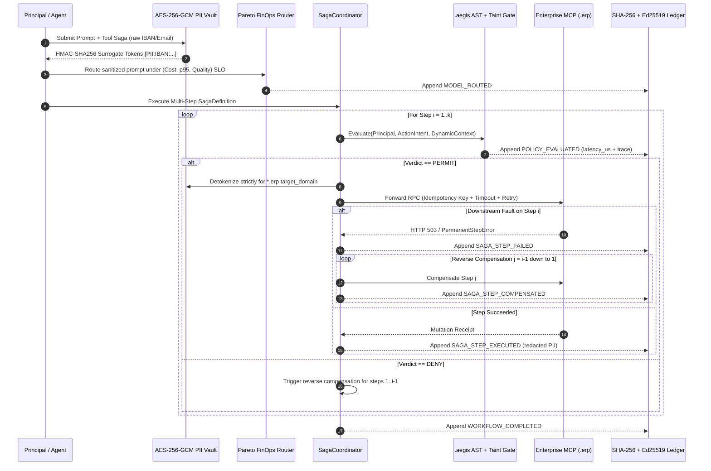
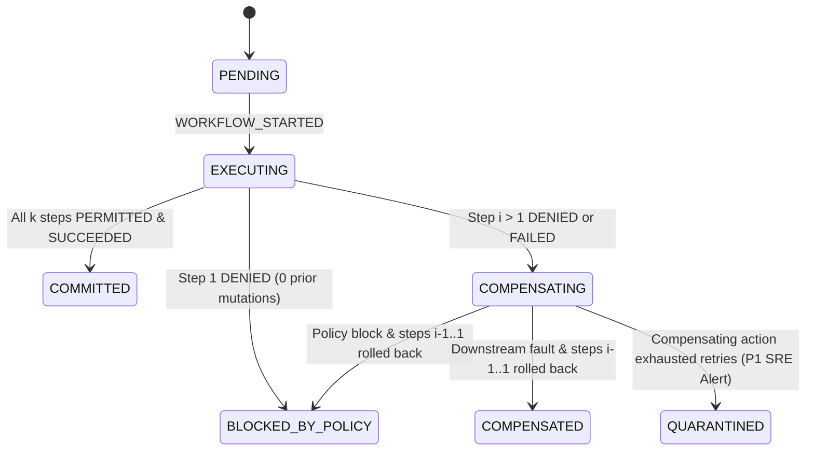

# AegisRuntime — System Architecture & Execution Lifecycles

## 1. Layered Control-Plane Topology

`AegisRuntime` enforces a strict separation between **probabilistic planning** (LLMs routed via `ParetoModelRouter`) and **deterministic state mutation** (governed by `PolicyEngine`, `TaintAnalyzer`, `PIITokenVault`, `SagaCoordinator`, and `EventLedger`).

## 2. Saga State Machine

## 3. Repository Module Map

| Package | Responsibility | Key Classes / Algorithms |
| :--- | :--- | :--- |
| `aegis.policy` | Custom DSL compiler & information-flow security | `tokenize_policy`, `compile_policy`, `PolicyEngine`, `TaintAnalyzer` |
| `aegis.privacy` | Reversible cryptographic pseudonymization | `PIITokenVault` (HMAC-SHA256 + AES-256-GCM with tenant AAD) |
| `aegis.ledger` | Tamper-evident append-only audit journal | `EventLedger`, `MerkleTree` (RFC-6962 `0x00`/`0x01`), `LedgerSigner` (Ed25519) |
| `aegis.saga` | Orchestrated distributed transactions | `SagaCoordinator`, `IdempotencyStore`, reverse-order compensation |
| `aegis.router` | Multi-objective FinOps routing & resilience | `ParetoModelRouter`, `CircuitBreaker`, `TenantTokenBucketLimiter`, `SemanticVectorCache` |
| `aegis.replay` | Deterministic replay & policy blast radius | `ReplayEngine.replay_workflow`, `simulate_counterfactual_policy` |
| `aegis.enterprise` | SAP S/4HANA-inspired ERP & JSON-RPC 2.0 MCP | `EnterpriseERPSandbox`, `EnterpriseMCPServer`, `EnterpriseScenarioCatalog` |
